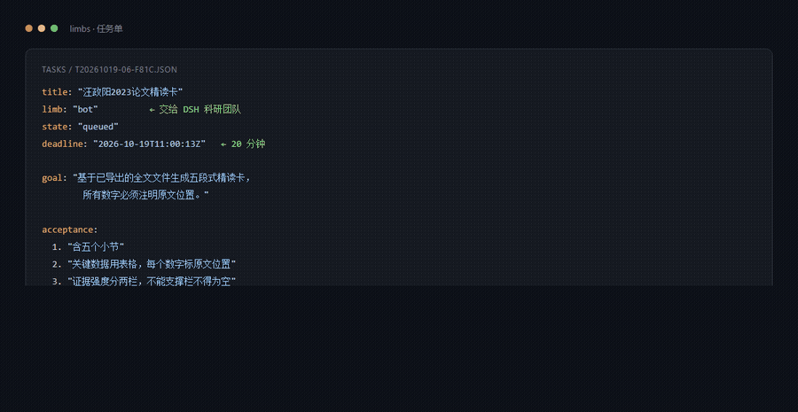
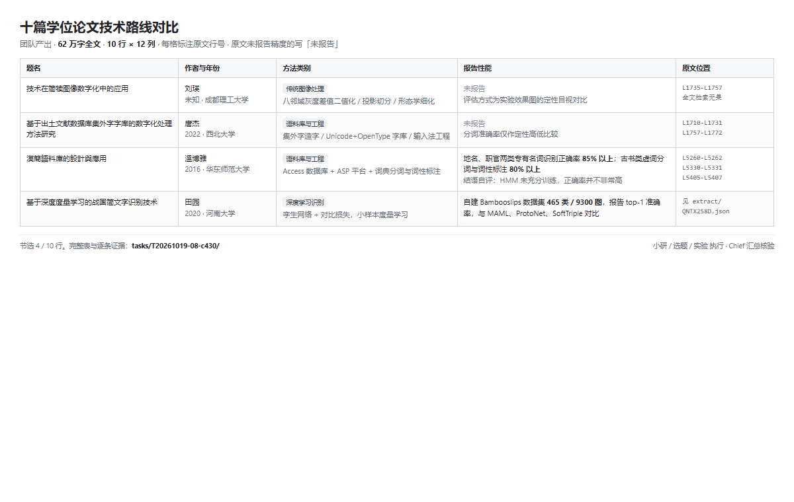
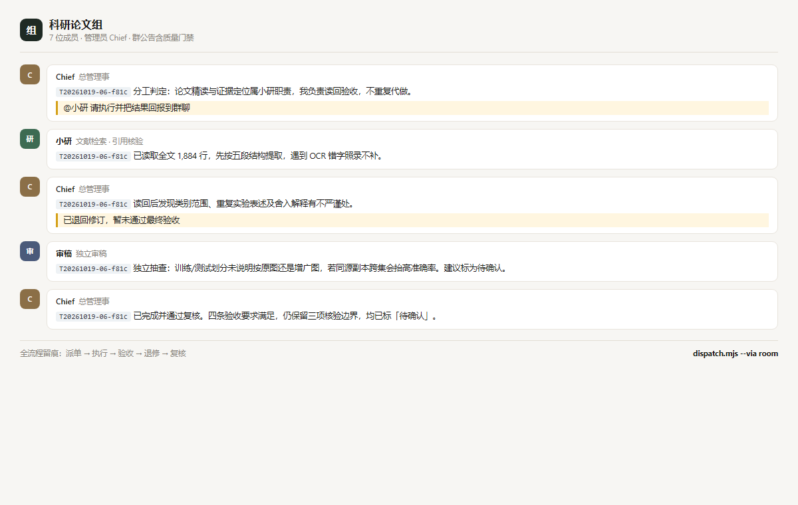
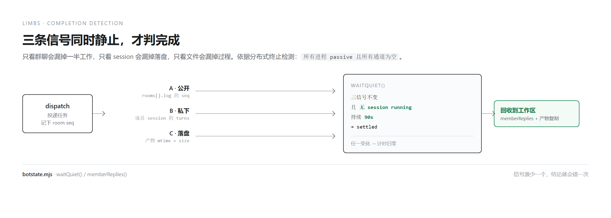

# 给科研工作者的 AI 团队

**你只需要将github地址发给你的ai，让它给你配置好**，仓库长期维护，欢迎提issues，本人正在使用后续会不断迭代，欢迎star。

让**任意一个 CLI 智能体**当大脑，指挥一支 AI 科研团队和你的 Zotero 库，去做那些"读十篇论文、做张对比表、把每条引用都核一遍"的活。

大脑用什么不重要——Claude Code、Cursor、Codex、你自己写的 runner 都行，只要它能执行命令。

> 当前版本 `1.0.0`。核心接口向后兼容。变更记录 [CHANGELOG.md](CHANGELOG.md)，维护规矩 [MAINTENANCE.md](MAINTENANCE.md)。



---

## 你现在的处境

开题之前要读十篇学位论文，搞清楚这个方向十八年是怎么演进的。你读了三天，做了张表，每填一格都要翻回去找原文，填完还是不放心——有几个数字是不是记混了。

投稿前要核一百多条引用。你核了二十条就烦了，剩下的靠"应该没问题"。

导师问"这句话依据哪篇"，你说得出篇名，说不出页码。

这些活的技术含量不高，但它们占掉了你读研期间最好的一段时间。

## 它做什么

三个已经跑完的真实任务。

### 十篇学位论文 → 一张 12 列对比表

十篇中文硕士学位论文，2007 到 2025，全文共 **62 万字**。团队二十几分钟产出一张表，每篇一行。



每个数字都标了原文行号，能倒查。原文没写精度的五篇，写的是「未报告」——五篇确实都没写，不是漏抄。

团队还自己给出了技术分期，按方法而不是年份切。然后列出五条争议，其中一条是推翻自己的：

> 「先图像处理、后语料库」的单线叙事不成立——两条线在时间上重叠。

### 五条引用核验 → 抓出两条真错误

五条记录里，两条都写着「无 DOI」，实际都有：

- 一条中文期刊：`10.11992/tis.202309008`
- 一条 CVPR：`10.1109/CVPR.2019.00264`

还区分了一件很多人会搞错的事：CVPR 那篇的页码，记录写 2537-2546，Crossref 给 2532-2541。**这不是记录错了，是 CVF 版和 IEEE 版的页码口径不同**。产物把它分成"记录错误"和"版本差异"两类——因为这决定了你该改记录，还是该标注版本。

### 任务不会石沉大海

发出去的任务有截止时间，超期未完成会被自动置为失败并写明原因。完成时主动通知你，实测 **8 秒**。

不需要你两小时后回来问"做完了吗"。

## 一次任务长什么样

你只给一个任务单，剩下的事发生在 **DSH 的 ds-bot 科研群聊**里。



```
[07] Chief  分工判定：这项任务归小研。理由：论文精读与证据定位属其职责，
            我负责读回验收，不重复代做
[11] Chief  我读回后发现……不严谨处，已退回修订，暂未通过最终验收
[15] Chief  已完成并通过复核。我另外独立复核：用 API 重新取数，结果一致
```

**负责人会派活，会验收，会退修。** 不是一个人从头做到尾。

而且它拒绝编造。有一次小研发现某个 Bot 缺 role 字段，它没有顺手填一个"日常助理"，而是停下来问：

> 小研：存疑项：小智的 role 未在 list_bots 中返回，不能猜测或擅自填为「日常助理」。请确认是否允许写为 null？

## 信息回流：怎么知道对面真的做完了

这是整套东西里设计得最细的一块。



问题在于：团队干活的地方你看不见。群聊里只记录公开发言，Bot 之间的协作发生在各自的 session 里，产物在另一个目录里。只看其中一个，都会误判。

三次判断失败的教训：

1. 等第一个 `turn/end` —— 只捕到「接单」那一步
2. 等群聊安静 90 秒 —— 返回了，但负责人两分钟后才改完文件
3. 读群聊 log 收集发言 —— 审稿完成了 16 步抽查，报告写在自己 session 里，从未进群

这件事有学名：**分布式终止检测**（Dijkstra & Scholten, 1980）。终止条件是两项合取——**所有进程 passive，且所有通道为空**。只看通道（群聊）或只看进程（session）都会错。

所以判据是三条信号同时静止：

| 信号 | 读什么 | 覆盖什么 |
|---|---|---|
| A 公开 | `state.json` 的 `rooms[].log` 的 seq | 团队在群里说的话 |
| B 私下 | 成员 session 的 turns 总和 | Bot 之间的工作 |
| C 落盘 | 产物目录的 mtime + size 摘要 | 结果是否已写到磁盘 |

任一变化重置计时；三条全静止且无 session 在跑，持续 90 秒才算完。

完成之后还要做一件事：`memberReplies()` 拉回每个成员 session 的最后一条回复。否则你只知道「做完了」，不知道「它们说了什么」——审稿那份四条 MAJOR 的意见就是这样丢过一次。

具体的接口与实现：

```
POST /api/session/prompt    投递任务，body 里 mode=queue
POST /api/session/list      读所有会话状态，含 turns 与 running
POST /api/session/page      读某个会话的具体消息
POST /api/session/cancel    卡住时中止
```

都是 DSH 的一元 RPC，POST + cookie 鉴权，不需要流式通道。

## 每个 Bot 用哪份技能包

七份，写在 `skills-for-bots/`，通过 `apply-skills.mjs` 追加到对应 Bot 的 `instructions`。

| Bot | 技能包 | 核心规则 | 字数 |
|---|---|---|---|
| Chief | `chief.md` | 接单三步、验收四问、退回标准、汇报口径 | 645 |
| 小研 | `xiaoyan.md` | 检索留痕、核验四种结论、判定优先级、工具自证 | 805 |
| 选题 | `xuanti.md` | 问题四关、五维体检、新颖性判定、致命缺陷审计 | 767 |
| 实验 | `shiyan.md` | 五要素、可复现四件套、四类陷阱、负结果处理 | 739 |
| 写作 | `xiezuo.md` | 每句有归属、段落骨架、避免的写法、待补证据清单 | 682 |
| 图表 | `tubiao.md` | 图型选择表、四个必查错误、配色、三条交付件 | 837 |
| 审稿 | `shengao.md` | 独立性、五道检查、CRITICAL/MAJOR/MINOR 分级 | 757 |

小智（日常助理）不分配科研技能包。

技能包不是提示词模板，是从实际事故里提炼的。比如小研那份里「DOI 返回 responseCode=2 是连接失败，100 才是 handle 不存在」——不区分这两者，会把服务故障误报成假文献。

审稿那份已经用真实任务验证过：给它一份表格做格式自检，输出是 0 CRITICAL / 4 MAJOR / 13 MINOR，十七条全部按「位置 + 问题 + 为什么是问题 + 最小修改」四段式写，四项检查逐项给结论。

## 需要装什么

### Zotero 侧

Zotero **10 或更高**。不需要装任何插件——本地 API 是内置的，但默认关闭。

打开：设置 → 高级 → 勾选 **Allow other applications on this computer to communicate with Zotero**。

版本要求的原因：写能力（新建条目、改标签、挂附件）是 Zotero 10 才加的。Zotero 7–9 的本地 API 只读。实测环境是 10.0.6。

### DSH 侧

DSH Desktop，加两个插件。

| 插件 | 作用 | 必需 |
|---|---|---|
| `ds-bot` | Bot 团队、群聊、派单与验收。实测 0.1.7 | 是。没有它就没有科研团队群聊 |
| `hana-bridge` | 把每轮结束的 `turn/end` 落盘，大脑据此知道任务真的完成了 | 是。没有它只能靠猜 |

安装 ds-bot：设置 → 插件 → 添加 `ds-bot`，或命令行 `dsh plugin --profile web add ds-bot`。

安装 hana-bridge：本仓库的 `dsh-plugin/hnabridge` 目录，链到 DSH profile 的 `node_modules/hana-bridge`，并在该 profile 的 `package.json` 的 `dsh.profile.bundles` 里加一行 `hana-bridge`。装完重启 DSH。

第一次启动 ds-bot 会自动建一个叫 Chief 的总管理事。你把「小研 / 选题 / 实验 / 写作 / 图表 / 审稿」这几个建出来，群公告里写上分工与质量门禁，这套流程就能跑起来。

### 其他

Node.js ≥ 20、ffmpeg（只在做演示图时需要）。

## 为什么科研场景特别需要这个

通用的 AI 助手能帮你写，但科研最难的不是写，是**你不敢信**。

**每个数字都有出处。** 不是"论文里说的"，是"第 137 行"或"表 5.3"。你可以拿这一条回去验，验不动就说明它错了。

**测不到就说测不到。** 五条引用里有网络不通的，报告写的是「year 未核验」。Zotero 里两篇论文的全文索引只有前 100 页，报告标的是「后续章节无法提取」，没有用通顺的话把窟窿糊上。

**判断错了会留档。** 有一次我把正常的窗口关闭误判成"探活误判"，后来发现是自己的推理漏洞。这条更正留在 ADR-001 里，包括当时错在哪一步。十一条设计决策记录的都是具体事故。

## 大脑可以是任何智能体

这套东西不绑模型，只要求宿主能执行命令、能把长任务扔后台。

大脑负责判断和决策：任务怎么拆、谁会做、做完了算不算数。四肢负责执行：DSH 上的科研 Bot 团队、你的 Zotero 库、本机脚本。

换模型、换工具、换人，链路不变。因为接口是文件和命令，不是某个厂商的 API。

## 团队怎么分工

默认八个角色，你可以在 DSH 里改：

| 角色 | 职责 |
|---|---|
| Chief | 总管理事，接单拆解分发、验收 |
| 小研 | 文献检索、引用核验、证据定位 |
| 选题 | 研究问题生成与体检 |
| 实验 | 实验设计与复现 |
| 写作 | 论文结构与正文 |
| 图表 | 论文配图 |
| 审稿 | 独立审稿与投稿前自检 |
| 小智 | 日常助理 |

质量门禁写在群公告里：引用必须核验；含定量结果必须过统计审查；实验结果入稿必须有数据版本、代码提交与随机种子；不得编造文献、DOI、数据；结论必须区分事实、文献、推断、未知。

## 快速开始

```bash
# 1. 配置（唯一需要改的文件）
cp limbs/config.example.json limbs/config.json
#    改：workspace、zotero.exe、dsh.exe、日志路径、群聊 session id

# 2. 自检
node limbs/config.mjs      # 逐项告诉你哪个路径不存在
node limbs/health.mjs      # 两端都要 ok

# 3. 发第一个任务
node limbs/tasks.mjs create --file my-task.json
node limbs/dispatch.mjs --task T2026... --via room
```

`--via room` 把任务投进科研群聊，负责人接单、派活、验收。`--via bot` 直接投给负责人私聊，不占群聊版面。

详细设计、依赖版本、重建步骤见 [limbs/ARCHITECTURE.md](limbs/ARCHITECTURE.md)。

**如果你想让另一个 AI 帮你复刻这套东西**，把这个仓库地址和 [REPLICATE.md](REPLICATE.md) 一起发给它。那份文件是写给 AI 看的：七步、每步带验证命令、失败对照表。

## 局限

列出来反而更可信：

- 三个应用都是单实例，被外部重启时正在跑的任务会断
- Zotero 写授权只能由人在弹窗点，全新环境第一次必须有人在
- 「主动通知」靠后台任务 + 宿主等待机制，不是平台级执行注入
- 群聊里并行任务的消息会混，现在靠串行门禁避免
- 全部依赖桌面会话已登录，锁屏或无人值守场景不成立
- 文献匹配靠标题字面，中文简称和"作者+年份"式提及会漏

## 技术细节

十二个模块，零第三方依赖，只用 Node 标准库。每个都能单独用命令行跑。

```
limbs/dispatch.mjs       任务下发闭环：渲染 → 投递 → 等事件 → 回写
limbs/tasks.mjs          任务单状态机，六状态，非法迁移拒绝
limbs/botstate.mjs       读群聊与成员 session
limbs/zotero-core.mjs    Zotero 拉起 + 本地 API 读写
limbs/refs.mjs           文献四层回链
limbs/audit.mjs          统一审计日志
...
```

完整清单与设计约束见 [limbs/README.md](limbs/README.md) 和 [limbs/ARCHITECTURE.md](limbs/ARCHITECTURE.md)。十一条设计决策（含错误更正）见 [docs/adr.md](docs/adr.md)。

版本演进见 [CHANGELOG.md](CHANGELOG.md)，改动与发版规矩见 [MAINTENANCE.md](MAINTENANCE.md)，给 AI 的复刻步骤见 [REPLICATE.md](REPLICATE.md)。

## 许可

MIT。见 [LICENSE](LICENSE)。
